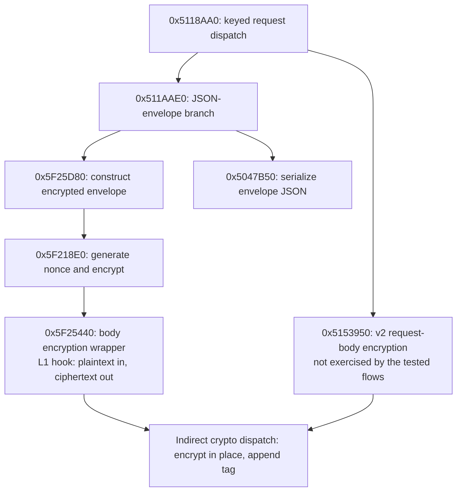
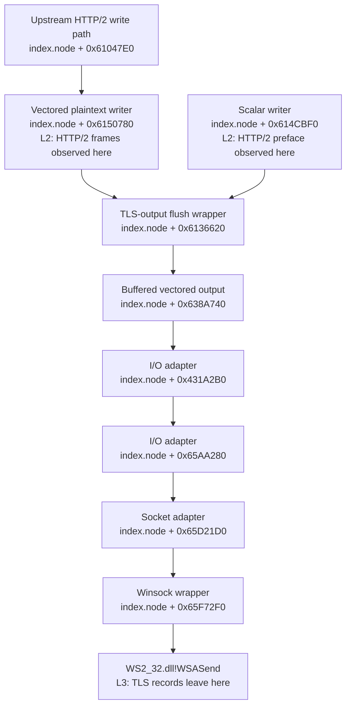

# 1password-leaktest

Tools to verify, by direct observation, that the 1Password for Windows client
never transmits the account Secret Key. The core is one read-only DLL injected
into the client process, watching the same traffic at three layers:

| Layer | What it shows | Question it answers |
|---|---|---|
| L1 session-body | Request-body plaintext at the moment it is encrypted into a session envelope | What can the 1Password server read? |
| L2 HTTP/2 | Request bytes before TLS, reassembled per connection | What is sent, in plaintext, per request? |
| L3 Winsock | TLS records on the socket | What actually leaves the machine? (ciphertext) |

The DLL never modifies arguments, return values, or TLS verification, and it
never dereferences the encryption key/context argument of the routines it
observes. It counts, live, whether every encrypted envelope on the wire was
seen *before* encryption — an unmatched envelope means an encryption path the
hooks did not cover, so "no key found" is only meaningful while that counter
is zero.

**Result on the tested build:** during account creation and sign-in, the
Secret Key appeared in no observed request, including the plaintext of every
session envelope. What left the machine matches the published SRP design:
email, a public key *identifier*, and a cryptographic proof of knowledge of
the key. Not the key. The same key was still in the main process after the
app was locked, and under ordinary memory pressure one of those copies was
written to `pagefile.sys`.

*Tested November 26, 2026, on the author's own Windows 11 machine with a
throwaway account created for the test and deleted afterwards.*

## Tested build

Installed from `1PasswordSetup-latest.msixbundle` (505,549,919 bytes):

```text
SHA-256  732ADE3A8B2DB27D8EA339C7F9FC46DE37DA54DE84B1625ED09452153AB67D53
SHA-1    DDABE590474CBFC3075F7CF9B99429442F9379A1
```

Bundle identity `Agilebits.1Password` version `8.12.46.29`, publisher
`CN=Agilebits, O=Agilebits, L=Toronto, S=Ontario, C=CA`. Running package
`Agilebits.1Password_8.12.46.29_x64__amwd9z03whsfe`; native module
`index.node` SHA-256 `3ddfb31d515b3776756047236c59725202a10387cd60ddfda26ce86295c75821`.

Each hook verifies the entry bytes of its target routine for this exact build
and refuses to install on a mismatch — a wrong build disables the hook with a
log line instead of crashing the client.

## Scope

Use this only on a machine and account you own. A disposable account is the
right target. The console and log show request plaintexts (device identifiers,
feature flags, session envelope contents) — keep the log local. Nothing here
needs your Secret Key: the watcher matches the *shape* of a formatted `A3-…`
key; it is never given the value.

## Why test this

After the November 2026 backend breach (an attacker reached backend services
via an employee's GitHub account and copied customer metadata — [1Password's
writeup](https://1password.com/blog/update-on-nov-2026-security-incident)),
the reassuring claim was that vaults stay safe because 1Password never has the
Secret Keys. That claim is a design document until someone watches the wire.
This repo is the watching.

Workflows covered: adding an existing account and signing in, creating a
brand-new account and signing in with the key it just generated, locking, and
saving a vault item. Not covered: weeks of daily use, browser extensions,
mobile, account recovery, other builds, or other password managers.

## Method

The coverage check is cryptographic, not heuristic. Every session-encrypted
envelope on the wire carries a nonce and a ciphertext. The L1 hook records the
same pair at the encryption routine. If an envelope appears with no matching
seal, some encryption path is unhooked. Across the tested sign-in, all 5
envelopes matched an observed pre-encryption plaintext by exact nonce +
ciphertext equality — so the plaintext of every server-bound encrypted body is
known, not inferred.

A live decoy — a Secret-Key-shaped value pasted into a vault item title —
tripped the key watch immediately, so a quiet watcher is a watching watcher,
not a dead one:


*The viewer mid-session: the visible plaintext is vault-item metadata in the
session body; the watcher alarm and the `key-hits 2` counter are the decoy
firing. Below it, the same body after encryption — the 829-byte
ciphertext+tag is all the server receives.*

## What the client sent

Everything sent during a full clean-state sign-in (email + Secret Key +
password):

| Request | Contents |
|---|---|
| `POST /api/v2/auth/methods` | `email`, `userUuid` |
| `POST /api/v3/auth/start` | `email`, `skformat`=`A3`, 6-char `skid` (the public identifier half of the key), `deviceUuid` |
| `POST /api/v2/auth` | SRP `userA` |
| `POST /api/v2/auth/confirm-key` | `clientVerifyHash` |
| `POST /api/v2/auth/complete` | encrypted envelope → device metadata only (device UUID, client/OS version, userAgent) |
| `POST /api/account-features` ×4 | encrypted envelopes → feature flags / account-tier context only |
| Everything else | GETs (paths/headers), device hello |

The plaintext of every envelope was dumped and reviewed in full. No encoding
of the Secret Key — formatted, secret portion only, or dashless — appears in
any observed request. This is SRP working as designed, and it is why the
backend breach did not expose vault contents: 1Password never has the key.
The realistic follow-on from the stolen names and emails is phishing for the
key — that part of 1Password's customer advice is the part to repeat.

The same negative held for a second workflow. A new account was created and
signed in while the viewer was attached: five session envelopes, five matched
to an observed plaintext, zero unmatched, and an exact search of the session
log found the new key in none of the dumped buffers. The same search found
that key in the process afterward, so the miss is not a blind scanner.

## Where the hooks sit

Two graphs. Addresses are RVAs in `index.node` for build 8.12.46.29. Names
are analysis labels, not recovered symbols.

The session-encryption path that actually produced the `cty` / `kid` / `enc` /
`iv` / `data` envelopes. The JSON branch is the one exercised by sign-in and
account creation. The v2 branch (`0x5153950`) was identified statically and
was not taken by the observed requests; an unmatched envelope would be the
signal that it had been.



The path from HTTP/2 plaintext to the socket. This is a captured call stack,
not a complete static graph. L2 sits on the writers; L3 is TLS records at
`WSASend`. Encryption can fill the output queue before the flush, so the
session-encryption routine does not have to appear on this stack.



An earlier candidate, AWS-LC `EVP_AEAD_CTX_seal` around `0x6879B20`, was
hooked and then ruled out for this question. Every successful ciphertext it
produced matched a TLS record, and none matched a session envelope. Those
calls are L3, not L1.

## The key stays in RAM after lock

Method: `instrumentation/memory_key_scan.py`. `ReadProcessMemory` only. The
search string lives in the scanner process, not in 1Password. Counts and
addresses were recorded; surrounding memory was not copied out. The same
exact-byte search that found nothing on the wire found the key in the client
about seven minutes after sign-in, which is the control for the network
negative.

**Unlocked, first disposable account, main process:**

| Form | Copies | Where |
|---|---|---|
| Full key, UTF-8 | 1 | private heap |
| Full key, UTF-16LE | 4 | 3 private heap, 1 inside `textinputframework.dll` |
| Secret portion, dashless, UTF-8 | 3 | private heap |

The sign-in form's renderer process held one more full key, UTF-16LE. Other
processes had none. One helper process could not be opened. The dashless
*full* key was not present; the dashless *secret portion* was.

`textinputframework.dll` is Windows, not 1Password. The Secret Key field goes
through the normal text-input path, and that path keeps its own copy until
the process exits.

**After locking (~6 minutes later):**

| Form | Before → after lock |
|---|---|
| Renderer (sign-in form) | 1 → 0 |
| Full key, UTF-8 | 1 → **1, same address** |
| Full key, UTF-16LE, heap | 3 → 0 |
| Secret portion, UTF-16LE, heap | 3 → 2 |
| Secret portion, dashless, UTF-8 | 3 → **1** |
| `textinputframework.dll` | 1 → 1, dies with the process |

Two of the UTF-16 buffers were not wiped. The identifier prefix was
overwritten by a later allocation; the 26-character secret tail was still
sitting at the same addresses. A deliberate zeroize destroys the whole string
before the free. Ordinary `free` plus reuse looks exactly like this.

A second disposable account, created and signed in under the viewer, showed
the same shape and a stricter one. No renderer copy and no
`textinputframework.dll` copy this time (account creation does not use the
same form path). After lock, three copies were still there: one full UTF-8
string at the same address as before the lock, one full UTF-16LE string, and
one dashless secret. Lock is not a wipe.

The formatted key is an enrollment secret. Unlock uses the account password
and key material already stored locally. It does not need the `A3-…` string
to keep living in the heap.

Copies that disappeared at lock cannot be labeled "scrubbed" rather than
"freed and reused." Copies that are still there, at the same address, can.

## The key reaches the pagefile

Anything still resident at lock is eligible for `pagefile.sys`. That was
measured, not inferred. The scanner reads a Volume Shadow Copy of
`C:\pagefile.sys` and searches the exact key (full string, secret portion,
dashless, UTF-8 and UTF-16). It does not search for the `A3-` shape.

**Forced flush, first key, app locked.** Trimming the working set
(`SetProcessWorkingSetSize(pid, -1, -1)`) dropped it from about 709 MB to
1.7 MB and moved the dirty pages onto the Modified Page List (204 MB →
341 MB). Holding ~8.5 GB then drained that list to ~70 MB while the pagefile
grew by ~1.2 GB and auto-expanded from 11 GB to 25.6 GB. A shadow-copy scan
of the 25.58 GiB file found the key in hundreds of places: full UTF-8 ×326,
full UTF-16LE ×71, secret portion UTF-8 ×360, UTF-16LE ×71, dashless ×32 and
×49.

Attribution on that run is incomplete. The key had also been pasted into a
chat client and a shell, so those processes could have contributed copies.
The client's own key-bearing pages were on the dirty list and that list was
flushed, so its copies are in the file. Windows does not expose which slot
belongs to which process.

**Ordinary pressure, second key, app locked. This is the clean run.** The
key had been typed only into 1Password. A scan with no pressure found the
11.00 GiB pagefile clean. Lock left three copies in RAM, as above. Then
pressure only, no trim, on a 31 GB machine:

| Pressure | What the pagefile did |
|---|---|
| ~4 GB held for 45 s | Usage unchanged. Nothing flushed. Key still only in RAM. |
| ~8 GB held for 60 s | File grew 11.3 → 12.8 GB. Peak usage ~2.18 GB, about 800 MB newly written. One full UTF-8 copy of the key was in the file. The secret-portion hit started 10 bytes later, inside that same string. The UTF-16 and dashless copies were not paged out. |

So the channel does not need a trimmed working set. On this machine, a locked
client plus roughly 8 GB of ordinary allocation was enough. A machine with
less free RAM reaches that condition by itself. Full-disk encryption is what
makes the pagefile unreadable to someone who later has the disk. It does not
stop a process that can already read memory while the session is unlocked; the
scan above was a shadow copy taken from the logged-in session.

Hibernation was disabled on the test machine. A crash dump was not taken. A
full-process or full-memory dump is a snapshot of the same RAM, so the
locked-state key would be in it. That was not fired, and it is not claimed as
a collected file. Vault-item plaintext was visible at the encryption call,
which is where it has to be, and was not shown lingering the way the Secret
Key lingers.

## Run the check

1. Install the bundle above and confirm `index.node` matches the hash:

   ```powershell
   (Get-FileHash "$env:ProgramFiles\WindowsApps\Agilebits.1Password_8.12.46.29_x64__amwd9z03whsfe\resources\app.asar.unpacked\index.node").Hash
   ```

2. Build `gui/Winsock-Hook/Winsock Hook.sln` as **Release x64**. The MinHook
   static libs are bundled; the only toolchain requirement is MSVC.

3. Start 1Password, then inject:

   ```powershell
   python gui/inject.py
   ```

   The injector finds the `1Password.exe` process that has `index.node` loaded
   and calls `LoadLibrary` on the DLL. A console opens on the target process
   with a legend; everything is also appended to
   `%TEMP%\1password-leaktest\winsock-hook.log`.

4. Sign in to your disposable account (or create one) and watch the console
   title bar, which reads
   `env N = matched N + UNMATCHED N (+unparsed N) | key-hits N`:

   - `env` — session-encrypted envelopes seen on the wire (L2).
   - `matched` — envelopes whose ciphertext+nonce equal an observed L1 seal.
     **The invariant is `env == matched`.** `UNMATCHED > 0` means an
     encryption path the hooks did not see; a "key not found" result is void
     until that counter is zero. (Envelopes that could not be fully parsed are
     counted separately as `unparsed`, not as unmatched.)
   - `key-hits` — key-shape watch hits. Should stay `0` for the whole session.

5. Negative control: paste a Secret-Key-shaped string into a vault item title
   and save. The watcher must trip immediately.

6. Exact check: the L1 layer hex-dumps every envelope plaintext to the log
   (capped at the first 1 KiB per buffer — enough for any key-shaped value).
   Search that log for your key locally, in any encoding you care about:

   ```powershell
   Select-String -Path "$env:TEMP\1password-leaktest\winsock-hook.log" -Pattern 'A3-'
   ```

   The DLL never writes the key on its own; the log only contains it if the
   client put it in a request.

Console hotkeys: `F1`–`F3` toggle the Winsock send/recv/sendto hex logs,
`F4` toggles the L1/L2 research log, `F5` toggles the key-shape watch,
`F10` ejects the DLL. Initial states can be set in `winsock-hook.ini` next to
the DLL (`[log] send= recv= sendto= research= keywatch=`, `0`/`1`).

## Reading the layers honestly

- L3 (Winsock) is TLS ciphertext. A negative search at L3 alone proves
  nothing — that is what L1 and L2 are for.
- L1 fires for *all* session-envelope encryption, including local vault-item
  encryption, so `seals != requests` is normal. GETs and plain JSON POSTs are
  not session-encrypted and appear only at L2.
- The key watch is a formatted-`A3` shape heuristic. It will not catch every
  encoding, transformation, or a value split across buffers — the exact log
  search in step 6 is the strong check, and it only covers traffic the hooks
  saw (keep `UNMATCHED == 0`).
- Hook RVAs are for the tested build only. On any other build, re-derive the
  offsets and re-check the entry bytes (`instrumentation/static_probe.py` is
  the helper used for that); the DLL will refuse mismatched hooks on its own.

## Layout

| Path | Role |
|---|---|
| `gui/Winsock-Hook/` | Visual Studio solution for the viewer DLL (MinHook bundled). Build as **Release x64**. |
| `gui/inject.py` | Loads the DLL into the `1Password.exe` process that has `index.node` loaded. No third-party injector needed. |
| `scanpagefile.ps1` | Admin helper: shadow-copy `C:\pagefile.sys`, scan it for a key, delete the shadow. |
| `instrumentation/memory_key_scan.py` | Read-only scan of a process's memory for key encodings. The needle never enters the target. |
| `instrumentation/memory_pressure.py` | Trim a working set, or hold RAM so Windows has a reason to page. |
| `instrumentation/pagefile_scan.py` | Exact scan of a pagefile image. Called by `scanpagefile.ps1`. |
| `instrumentation/static_probe.py` | File-only disassembly/xref helper (pefile + capstone) for re-deriving hook offsets on a new build. Expects an analysis copy at `analysis/index.node`, which is not published. |

The `instrumentation/` tools are plain-stdlib Python (ctypes) except
`static_probe.py`. The DLL answers the network question. `memory_key_scan.py`,
`memory_pressure.py`, and `scanpagefile.ps1` are how the lock-state and
pagefile results above were produced. Usage notes are in
`instrumentation/README.md`.

## What this is not

Not a statement about other builds, Mac, mobile, the browser extension, or
account recovery. Not a claim that every password manager does this — only
this build was measured, and the class of bug (a long-term secret left in a
Windows process) is not unique to 1Password. Not a CVE in the author's view:
local memory exposure, previously reported against the prior architecture,
needs a local reader or a later copy of the disk. It does not contradict the
vendor's breach statement. Vaults were not in that backend dump because the
key stays client-side. On the wire, that part is confirmed. After lock, a
plaintext copy of the key is still in the process, and under memory pressure
it is written to `pagefile.sys`.

## References

The 1Password links are the current security-design white paper, checked
November 26, 2026. Section numbers in the live paper: key derivation is
§8, transport is §15, SRP is appendix B.

- [1Password: device enrollment and key derivation](https://agilebits.github.io/security-design/deepKeys.html)
- [1Password: transport-security layers](https://agilebits.github.io/security-design/transport.html)
- [1Password: SRP and session-key design](https://agilebits.github.io/security-design/srp.html)
- [1Password: update on the November 2026 security incident](https://1password.com/blog/update-on-nov-2026-security-incident)
- [AWS-LC AEAD source used for comparison](https://github.com/aws/aws-lc/blob/main/crypto/fipsmodule/cipher/aead.c) — `EVP_AEAD_CTX_seal` and `EVP_AEAD_CTX_seal_scatter`. Hooking these showed TLS records, not the session envelopes.
- [MinHook](https://github.com/TsudaKageyu/minhook) (Tsuda Kageyu) — the x86/x64 API hooking library the viewer DLL is built on. The headers and static libraries under `gui/Winsock-Hook/` are that project, BSD-licensed, bundled so the DLL builds without a separate checkout.
